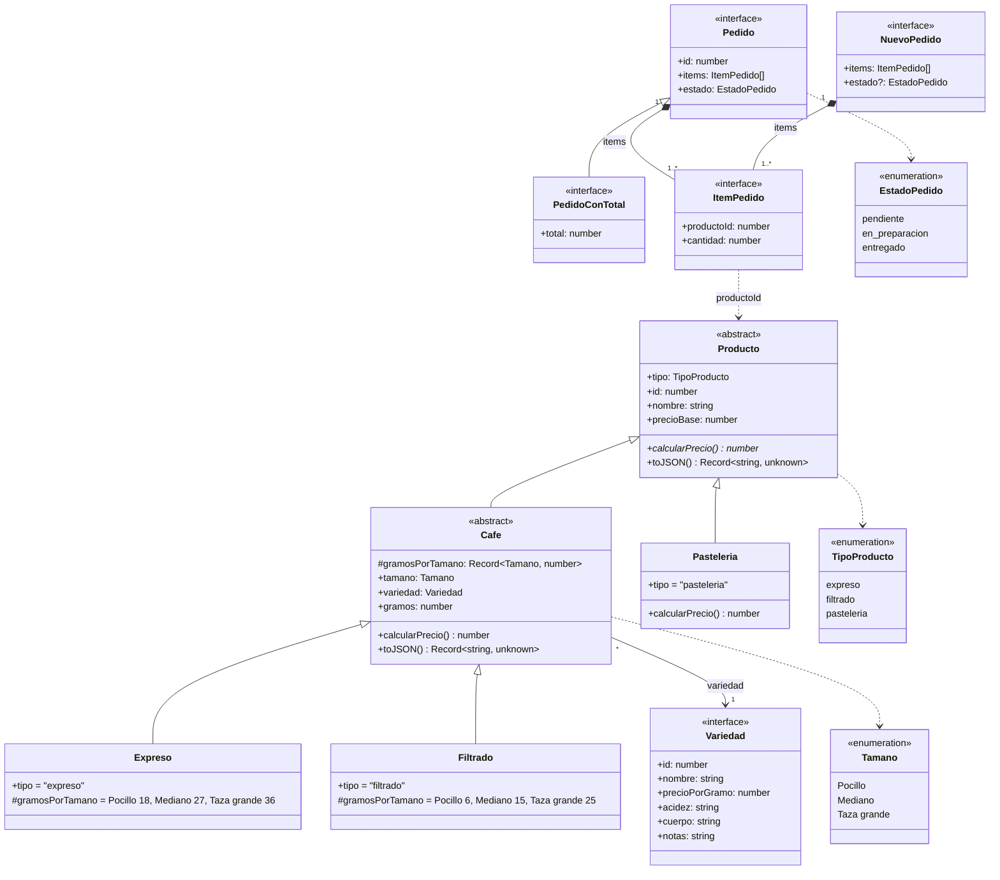
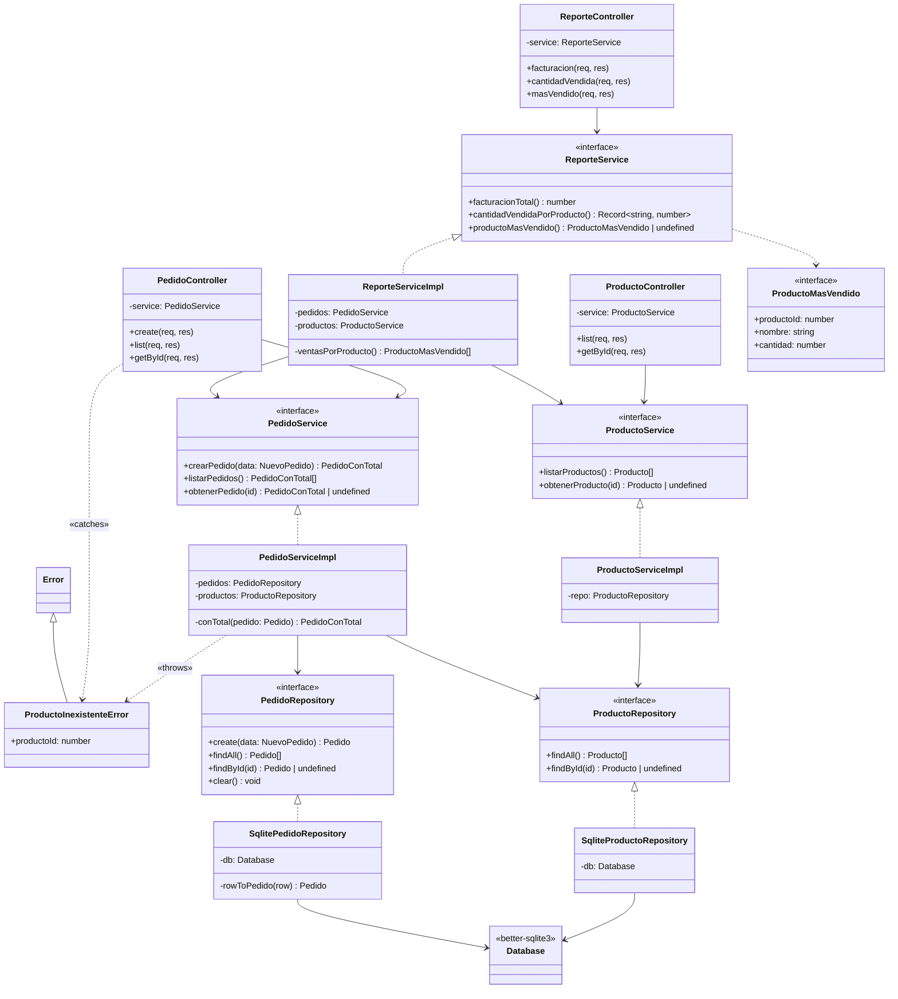
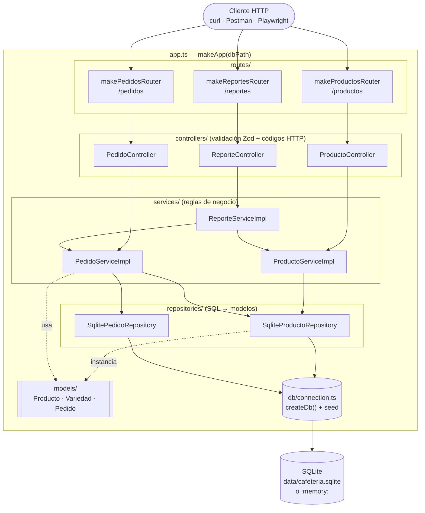
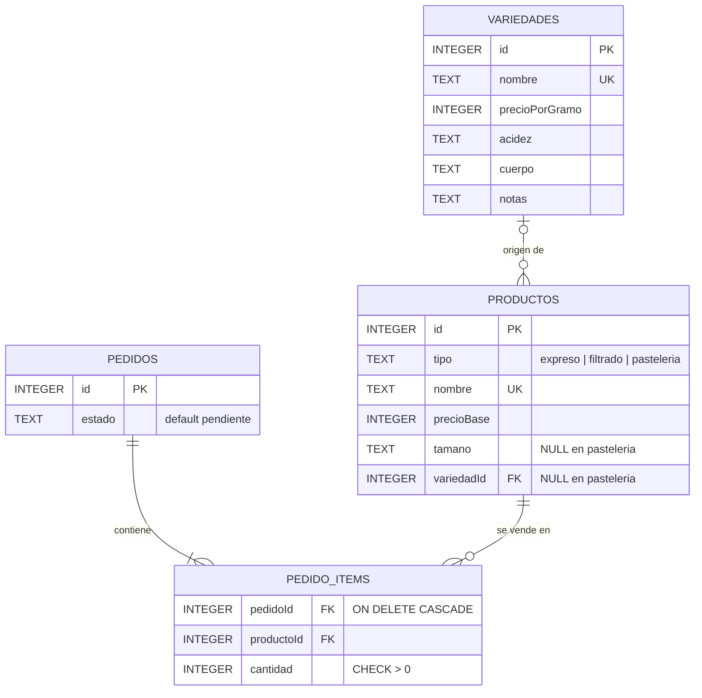
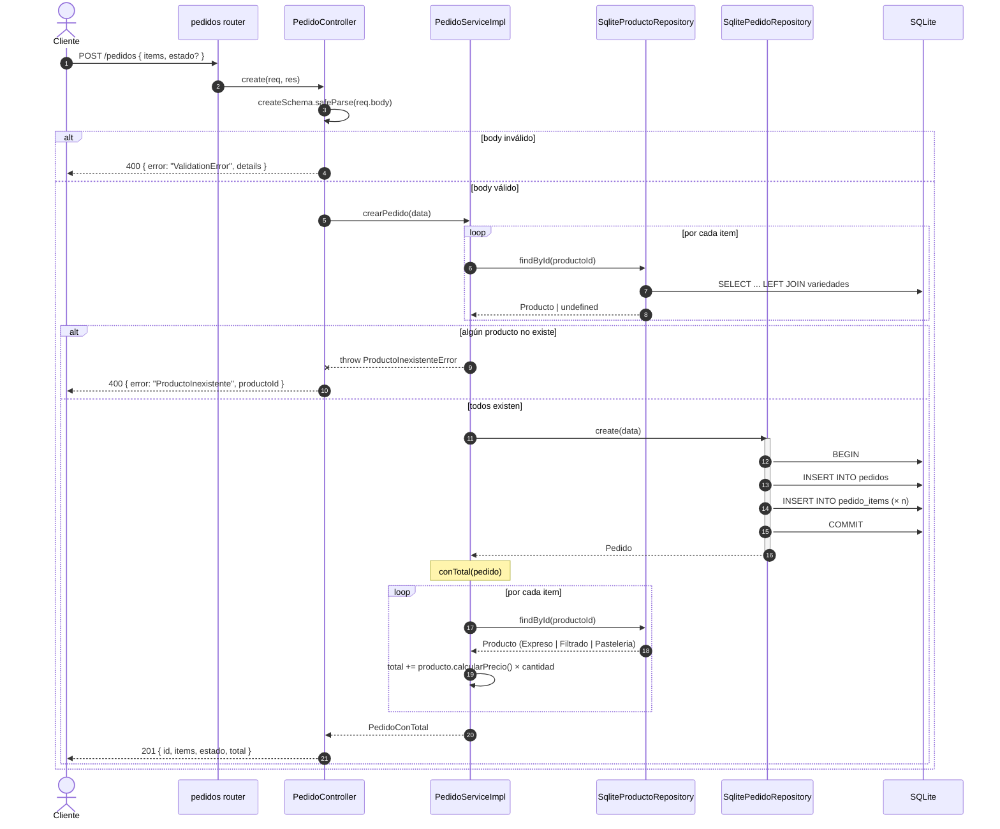
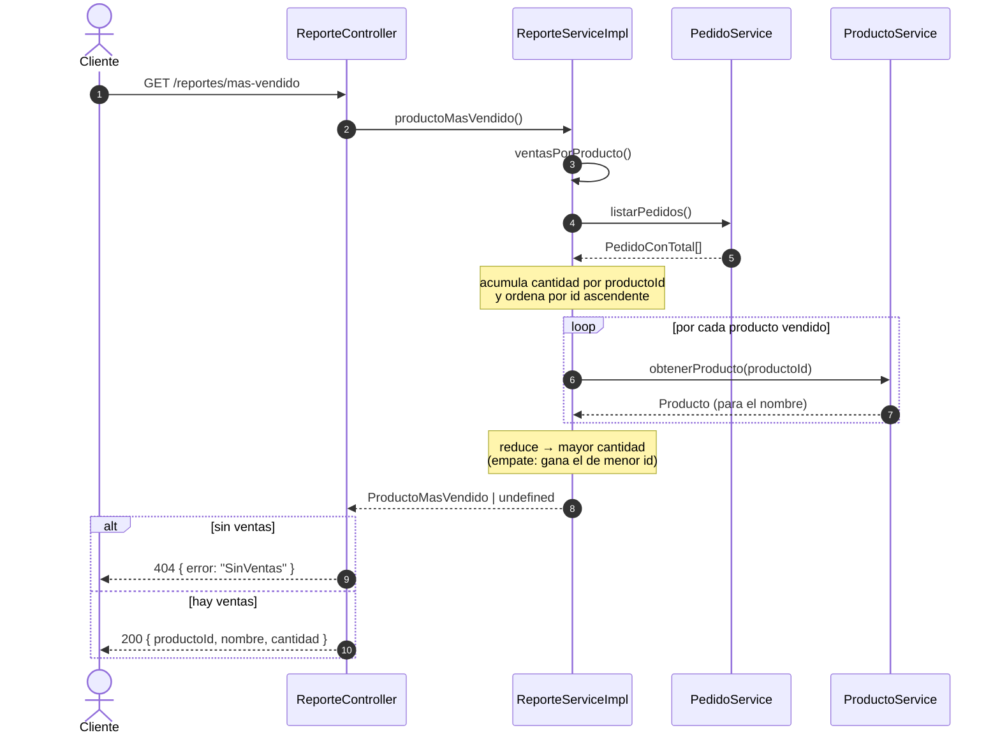
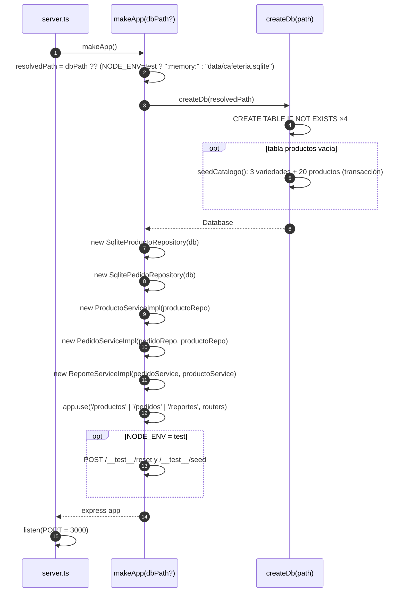

# Diagramas UML — Cafetería Origen API

Diagramas en [Mermaid](https://mermaid.js.org/): GitHub y VS Code (con la
extensión *Markdown Preview Mermaid Support*) los muestran renderizados.

1. [Diagrama de clases — Modelo de dominio](#1-diagrama-de-clases--modelo-de-dominio)
2. [Diagrama de clases — Capas de la aplicación](#2-diagrama-de-clases--capas-de-la-aplicación)
3. [Diagrama de componentes / paquetes](#3-diagrama-de-componentes--paquetes)
4. [Modelo de datos (SQLite)](#4-modelo-de-datos-sqlite)
5. [Secuencia — `POST /pedidos`](#5-secuencia--post-pedidos)
6. [Secuencia — `GET /reportes/mas-vendido`](#6-secuencia--get-reportesmas-vendido)
7. [Secuencia — Arranque (`makeApp`)](#7-secuencia--arranque-makeapp)

---

## 1. Diagrama de clases — Modelo de dominio

`Producto` es abstracta y cada subclase implementa `calcularPrecio()`
(polimorfismo). `Cafe` agrega tamaño y variedad; `Expreso` y `Filtrado` solo
definen los gramos por tamaño.

**Cálculo de precio:**

- `Cafe.calcularPrecio() = precioBase + gramos × variedad.precioPorGramo`
- `Pasteleria.calcularPrecio() = precioBase`
- `PedidoConTotal.total = Σ producto.calcularPrecio() × item.cantidad` (no se persiste)

---

## 2. Diagrama de clases — Capas de la aplicación

Cada capa depende de **interfaces** de la capa de abajo; `makeApp` es la
única que conoce las implementaciones concretas (inyección por constructor).
`ReporteService` se apoya en los servicios, no en los repositorios.

---

## 3. Diagrama de componentes / paquetes

---

## 4. Modelo de datos (SQLite)

`productos.tamano` y `productos.variedadId` son `NULL` para pastelería. El
total del pedido **no** es una columna: se calcula al leer.

---

## 5. Secuencia — `POST /pedidos`

---

## 6. Secuencia — `GET /reportes/mas-vendido`

---

## 7. Secuencia — Arranque (`makeApp`)

Muestra la composición de dependencias (*composition root*).

